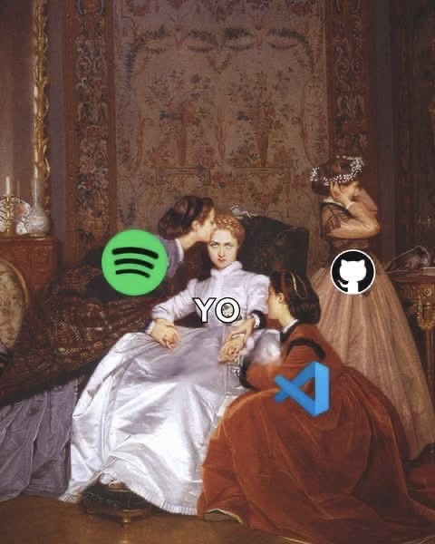

  

## Yo:

Estudiante de último semestre de Ingeniería en Sistemas Computacionales en el TecNM Celaya. A veces haciendo apps web, otras veces bases de datos, compiladores o haciendo procesos ETL pero siempre animado.

  
  

## Con lo que más trabajo

## Destacado

### [GasIQ](https://github.com/Victorml55/REPO)
Predicción de precios de gasolina en México. Pipeline EDA → ETL en AWS → modelo Prophet por estado → dashboard en EC2.
`Python` `Prophet` `PySpark` `MongoDB Atlas` `AWS` `Streamlit`

### [MediCitas](https://github.com/Victorml55/proyecto_final_medicitas)
Sistema de citas médicas con API REST, control de acceso por roles (RBAC), 5 CRUDs, correos automáticos y reportes en PDF.
`PHP` `PostgreSQL` `Docker` `Bootstrap`

### [KED](https://github.com/Victorml55/REPO)
Lenguaje de scripting con compilador propio en C99: análisis léxico, sintáctico y semántico, código TAC e intérprete, con interfaz web.
`C` `Python` `JavaScript`

### [BirriaDWH](https://github.com/Victorml55/REPO)
Data warehouse OLAP con cubo SSAS, dashboard en Power BI y modelo Naive Bayes con 86.83% de precisión.
`SQL Server` `SSAS` `Power BI` `scikit-learn`

  

